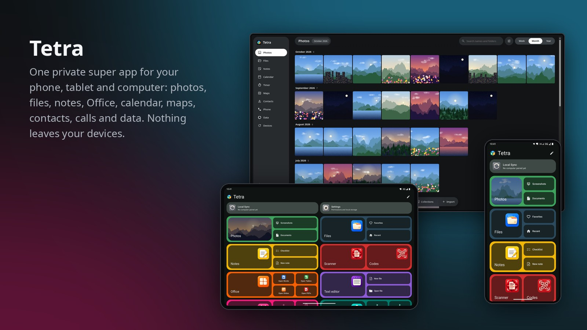
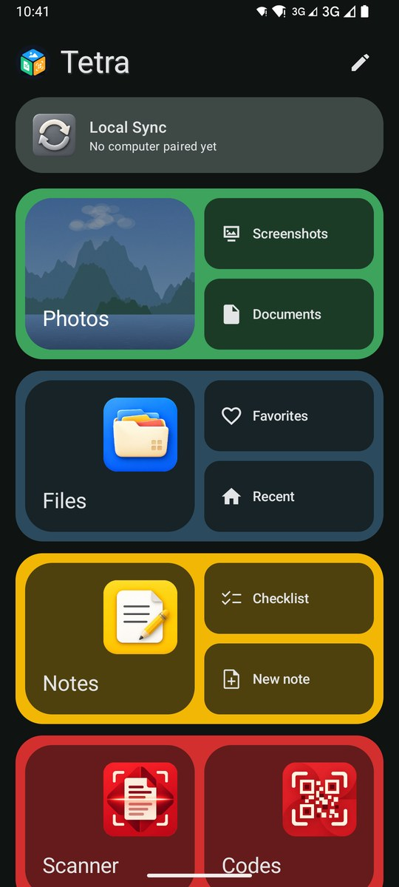
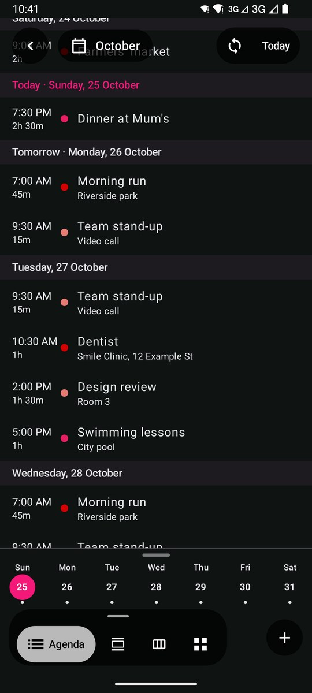
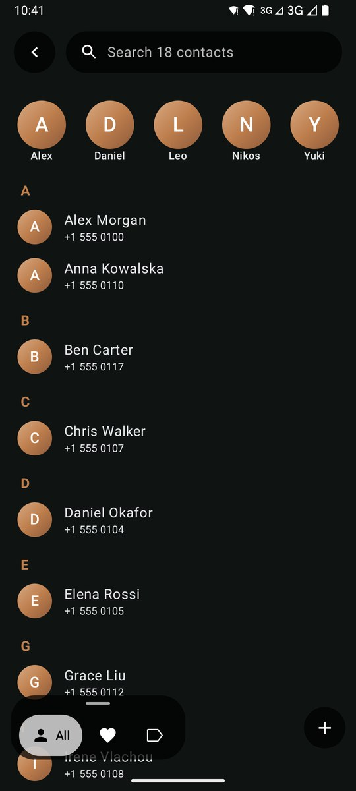
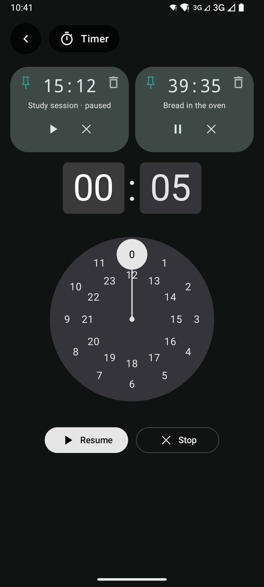
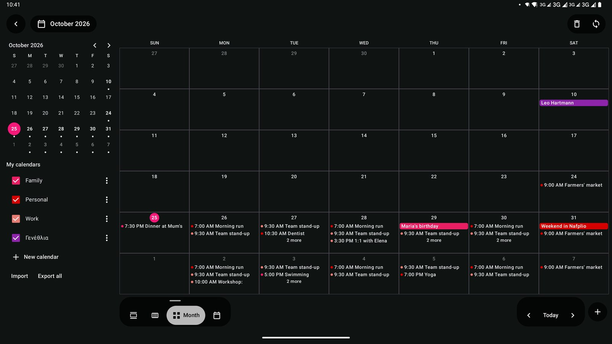
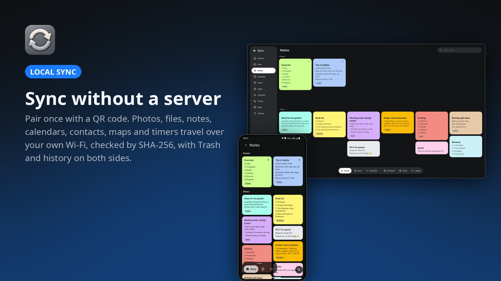

<h1 align="center">Tetra for Android</h1>

<p align="center"><b>One private super app for your phone, tablet and computer.</b><br>
Photos, files, notes, Office, calendar, timers, maps, contacts, calls and data, in one app that keeps everything on your own devices.</p>

<p align="center">
  <a href="https://github.com/kalotrapezis/Drive-Android/releases/download/v0.6.0-beta.1/Tetra-0.6.0-beta.1-arm64.apk"></a>
  <a href="https://github.com/kalotrapezis/Drive"></a>
</p>



Tetra replaces a dozen apps with one. Each **applet** (Photos, Files, Notes, Office, Calendar, Timer, Maps,
Contacts, Phone, Data, Scanner, Codes, Text editor) opens from Home and shares the same folder, `/sdcard/Tetra`.
[Tetra for the desktop](https://github.com/kalotrapezis/Drive) has the same applets on Linux. The two **sync over
your own Wi-Fi**, with no server, no account and no cloud. Faces, labels, text recognition, maps and routes are all
worked out on the device.

**Current release: 0.6.0 Beta 1.** A beta: in daily use by its author, but keep your own backups.

<sub>Every screenshot here uses invented sample data: made-up people, generated pictures, sample documents.</sub>

## New in 0.6 beta

- **Contacts**: your contacts as vCard files that sync, with faces from Photos, favourites, labels, birthdays in the
  Calendar, duplicates merged, imports from the phone or Google.
- **Phone**: Tetra can be the phone app. A keypad with search as you type, Recents, the call screen, hold, merge,
  block and spam lookup, and calls from the computer through the phone, with a call bubble on the PC.
- **Data**: what each app uses on mobile data and Wi-Fi, your plan's alerts and forecast, the hotspot, and Wi-Fi
  signal, spots and drops, for the phone, tablet and computer together.
- **Maps**: offline maps of Greece, search, places, routes by car, on foot and by bike, "Main roads" or "Shortest",
  voice guidance and Android Auto.
- **PDF editing**: notes, highlights, ink, stamps, forms, signatures, pages, passwords, true redaction and text
  recognition (Greek and English).
- **Settings** redesigned into categories with search; **Home edit mode** with three sizes per applet; an **icon for
  every kind of file** and thumbnails for pictures and video.
- **Every applet opens fast** (below).

## The applets


| | |
|---|---|
| **Photos** | Timeline by week, month or year; collections, favourites and folder albums; **People** (faces grouped on the device), **Documents** (receipts and papers found for you), a map, search by place, date or label, an editor, and an encrypted **Hidden** vault. It can be the default gallery. |
| **Files** | A file manager for `/sdcard/Tetra`: search, tags, favourites, folder colours, copy, move, rename, share, Trash, system folders, an icon for every kind of file. |
| **Notes** | Notes and checklists with colours, labels, pins, history and keyboard shortcuts. |
| **Office** | **Words** (`.docx`, `.doc`, `.odt`, `.rtf`) on a real page with rulers, styles, tables, pictures, comments, tracked changes and APA 7 citations. **Tables** (`.xlsx`, `.xls`, `.ods`, `.csv`) with charts and about 80 functions. **Slides** (`.pptx`, `.odp`) with themes, transitions, animations and a presenter view on a second screen. **PDF** with editing. Files open and save as themselves. |
| **Calendar** | Plain iCalendar (`.ics`) files: day, week, month and agenda, repeats, reminders, birthdays, import and export. |
| **Timer** | Timers that ring on every device, pinned on Home. |
| **Maps** | OpenStreetMap on the device, search, saved places, lists and trips, routes and guidance, Android Auto. |
| **Contacts** | vCard files with faces, favourites, labels and history. |
| **Phone** | The dialer, Recents, the call screen, blocking and spam lookup, and calls from the computer. |
| **Data** | Usage per app, plan alerts, the hotspot, Wi-Fi signal and drops. |
| **Scanner** | Scan paper to PDF: the page found live, straightened and cropped, filters, reorder, 300 or 200 dpi. |
| **Codes** | QR codes and barcodes, text in a photo, and Greek RF payment codes. |
| **Text editor** | Tabs for any text file, a symbols row, word wrap, Windows line endings kept. |

The full list is in [FEATURES.md](FEATURES.md).

## Phone, tablet and a big screen

Every applet has a phone layout and a tablet layout. On a tablet, Office is laid out like the desktop programs:
a real page with rulers and the ribbon, the slides in a sidebar, a mouse menu and the usual shortcuts.

<table>
  <tr>
    <td></td>
    <td></td>
    <td></td>
    <td></td>
  </tr>
</table>



## Fast


This release went through every applet, one by one, with the same recipe: nothing is read or worked out on the
screen's thread while it draws; the list shows first and side work comes after; read-ahead starts after Home's first
frame; small indexes in the app's cache mean a restart does not read every file again; and lists are made for
thousands of items, so Tetra left open for months does not grow. The build installed on devices is no longer
debuggable, which alone made Compose several times faster.

| On a Xiaomi 15, until the screen shows its content | before | now |
|---|---|---|
| Contacts, opened right after Tetra starts | 3.3 s | 0.19 s |
| Phone, opened right after Tetra starts | 2.3–2.8 s | 0.25 s |
| Tetra's start to its first frame | 924 ms | 157–253 ms |
| Home's first frame | 519–586 ms | 83–100 ms |
| Data | 2353–2426 ms | 157–194 ms |
| Notes | 348–407 ms | 45–66 ms |
| Calendar | 268–291 ms | 32–35 ms |
| Photos (tapped at once) | 619–667 ms | 266–375 ms |
| Office home | 711–881 ms | 59–65 ms |
| Files | 159–173 ms | 37–49 ms |
| Timer | 226–246 ms | 38–52 ms |
| Contacts | 157–218 ms | 32–38 ms |

On a tablet with 218 notes, Notes opened in about 450 ms instead of 1000 ms before the build change, and in about
90 ms after it.

## Sync with your computer



Pair once with [Tetra for the desktop](https://github.com/kalotrapezis/Drive) by QR code. Photos, files, notes,
calendars, contacts, places, timers and the phone's calls travel over your own network. Each file is checked by
SHA-256 on arrival. Rules per device: send only, both ways, or **Move** (keep a month on the phone, the rest lives on
the computer). The design and every rule's reason are in [SYNC_PLAN.md](SYNC_PLAN.md).

## Safety rules

- **Nothing is changed without asking.** Editing a photo in place goes through Android's own consent prompt;
  everything else saves a new file.
- **Deleting is always reversible first.** Items go to a Trash, then (on the computer) a purgatory, and only then
  away for good. Emptying the Trash always asks you first.
- **A copy counts only once it is verified.** A photo can leave the phone (Move) only after the computer has
  confirmed it holds the same bytes.
- **Files never leave `/sdcard/Tetra`.** Every path is checked against it.
- **Nothing is sent to anyone else.** No account, no analytics, no ads. Permissions are asked for only where they
  are used.

## Install

<a href="https://github.com/kalotrapezis/Drive-Android/releases/download/v0.6.0-beta.1/Tetra-0.6.0-beta.1-arm64.apk"></a>

Download the APK from [Releases](https://github.com/kalotrapezis/Drive-Android/releases) (`arm64` for nearly every
phone from the last few years) and open it; Android asks once to allow installs from your browser. Android 11 or
newer. Updates install over the old version and keep everything.

For your computer: [Tetra for the desktop](https://github.com/kalotrapezis/Drive) (AppImage or .deb).

## Build

Requires JDK 17 and the Android SDK (Gradle 8.14 does not run on JDK 25).

```bash
export ANDROID_HOME=~/Android/Sdk
export JAVA_HOME=/usr/lib/jvm/java-17-openjdk-amd64
./gradlew testDebugUnitTest assembleDebug
adb install -r app/build/outputs/apk/debug/app-arm64-v8a-debug.apk
```

Kotlin + Jetpack Compose, min SDK 30, target SDK 36. The package id `com.kalotrapezis.drive` keeps the app's old
name on purpose: changing it would make every existing install a different app.

## Documentation

| File | Purpose |
|---|---|
| [FEATURES.md](FEATURES.md) | What is implemented now, per module |
| [SYNC_PLAN.md](SYNC_PLAN.md) | Sync design and every rule's reason (the same file in both repos) |
| [Plan.md](Plan.md) | The work plan and its measurements |
| [HANDOFF.md](HANDOFF.md) | Where work stands |
| [THIRD_PARTY_NOTICES.md](THIRD_PARTY_NOTICES.md) | Bundled models and library licences |

## Licence

Tetra is free software, and will stay free. See [LICENSE](LICENSE) and, for the libraries it bundles (MuPDF under
the AGPL 3.0 among them), [THIRD_PARTY_NOTICES.md](THIRD_PARTY_NOTICES.md).
