<h1 align="center">Tetra for Android</h1>

<p align="center"><b>One private super app for your phone, tablet and computer.</b><br>
Free software, no account, no cloud: nothing leaves your devices.</p>

<p align="center">
  <a href="https://github.com/kalotrapezis/Drive-Android/releases/download/v0.6.0-beta.3/Tetra-0.6.0-beta.3-arm64.apk">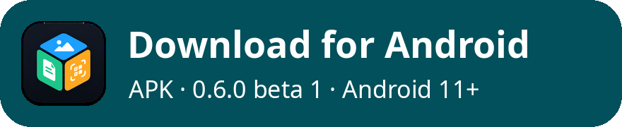</a>
  <a href="https://github.com/kalotrapezis/Drive">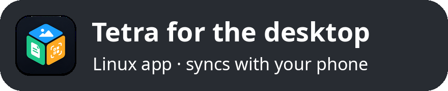</a>
</p>


Photos, Files, Notes, Office, Calendar, Timer, Maps, Contacts, Phone, Data, Scanner, Codes and a Text editor, as
**applets** of one app that share one folder, `/sdcard/Tetra`. [Tetra for the desktop](https://github.com/kalotrapezis/Drive)
has the same applets on Linux, and the two sync over your own Wi-Fi.

**0.6.0 Beta 3** ([what's new](https://github.com/kalotrapezis/Drive-Android/releases/tag/v0.6.0-beta.3)). A beta: keep
your own backups. Screenshots use invented sample data.

## What Tetra does for you

- **Files to and from your PC in a second.** Share anything to *Send to computer* on the phone, or *Send to phone* on
  the PC. It goes over your own Wi-Fi: no cable, no cloud. If the computer is away, it goes when it is back.
- **Call from your computer.** Click a number in Contacts on the PC and your phone dials it; a call bubble on the
  screen answers, holds, mutes, hangs up and moves the sound to the phone's loudspeaker.
- **Maps of any country, offline.** Pick a country on the computer: Tetra makes its map, search and routes from
  OpenStreetMap and sends them to your phone and tablet. Routes cross borders at the real crossings, with directions
  in your language.
- **In your language, with a guide.** All 24 official languages of the EU. A guide on first start, and any time in
  Settings, shows where to tap and why, step by step.
- **Your data plan, watched.** Tell Tetra your plan once. It notifies you at 50 %, 80 % and 100 %, or at any steps you
  choose, and forecasts the end of the month before you get there.
- **Calendar and timers, with AI.** Built-in skills (Settings › Calendar or Timer › *Share with Claude*) let Claude,
  ChatGPT or any assistant that can use your computer import a timetable, plan your week or start a timer: they simply
  edit the calendar's and timers' files, and Tetra syncs the result to your phone.
- **Notes and lists, organised.** Keep your notes and shopping lists organised with tags and in sync between the phone
  and the computer. Each note is a plain file in your own Tetra folder.
- **Photos that know who and where.** Tags, live photos, and People and Documents collections from face recognition
  that runs on the device. Find photos by place\*, and bring your Google Photos over (Takeout import on the computer).
- **Scan any page clean.** Filters and automatic cropping find and straighten the page: all the tools you need to make
  a perfect digital copy, for as many pages as you like.
- **Hide what should stay private.** Redact PDFs and photos so the hidden part is removed from the file itself, not
  just covered. Tetra finds the eyes in a photo and covers them with black bars or stars, and finds text to hide.
- **Office and PDF, good enough.** Word, Excel and PowerPoint open and save as themselves, compatible enough for
  everyday work; PDFs are edited the way Words edits; films and sounds inside documents play; and a phone layout you
  can actually use.
- **More than one copy, no subscription.** Tetra shows how many places hold each file, the phone, the tablet, the
  computer or a USB drive, and what still lives in only one. Your own backups, with no cloud plan to pay for.
<sub>\* Finding photos by place covers Greece only for now.</sub>

## The applets

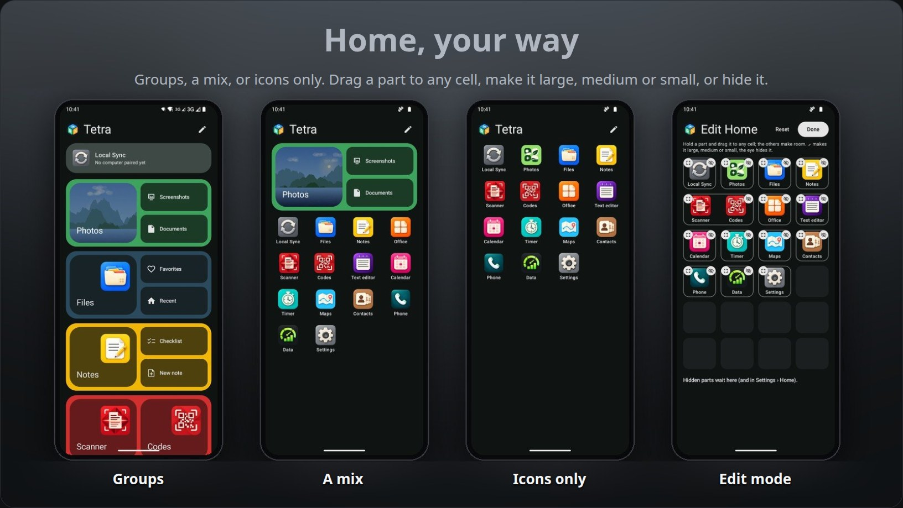
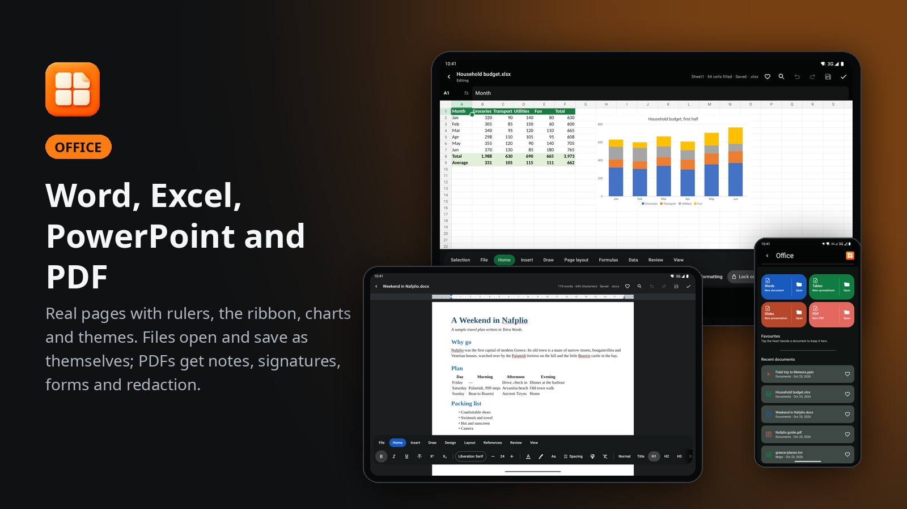

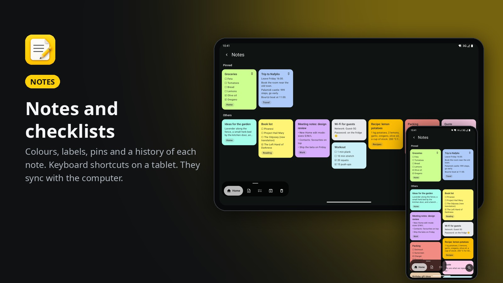

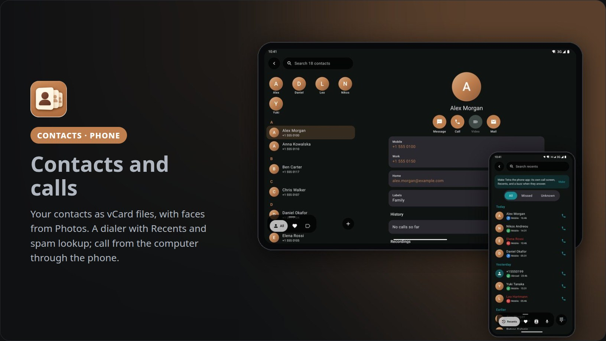

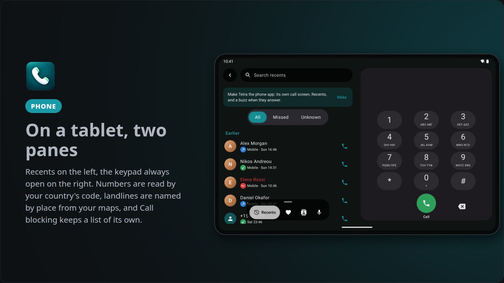
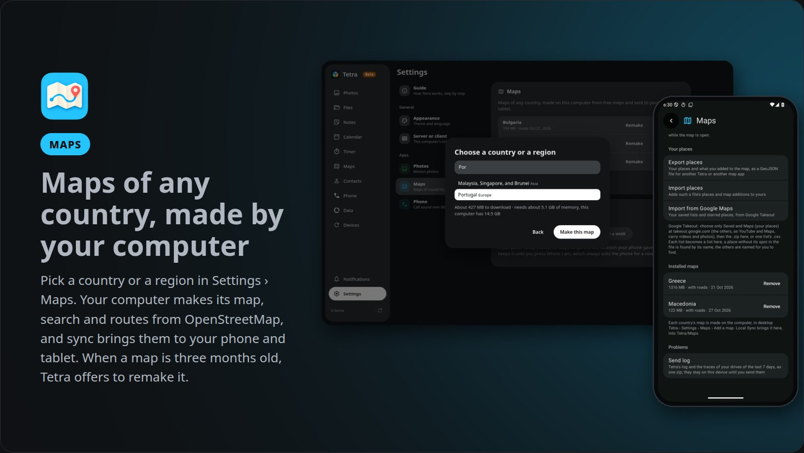
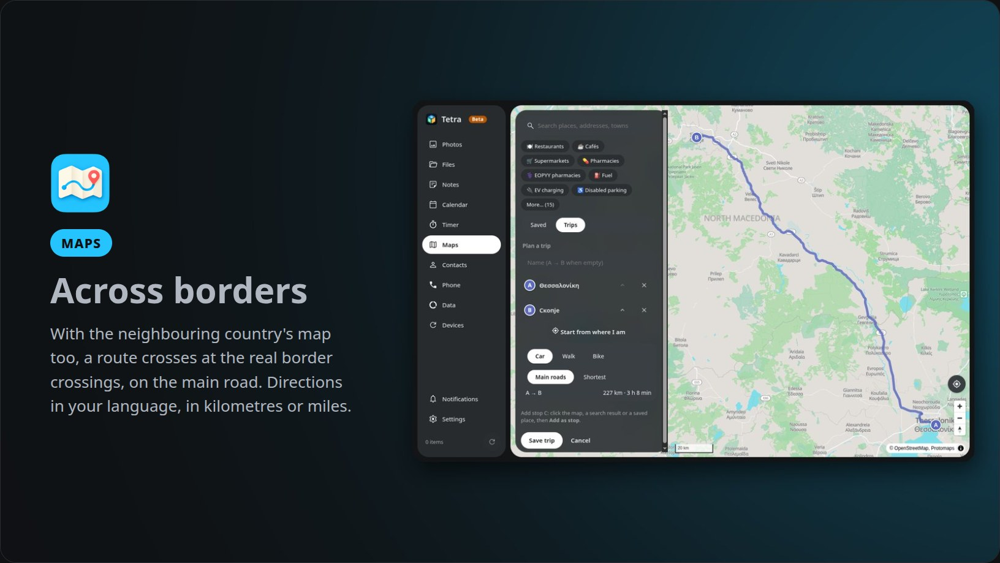
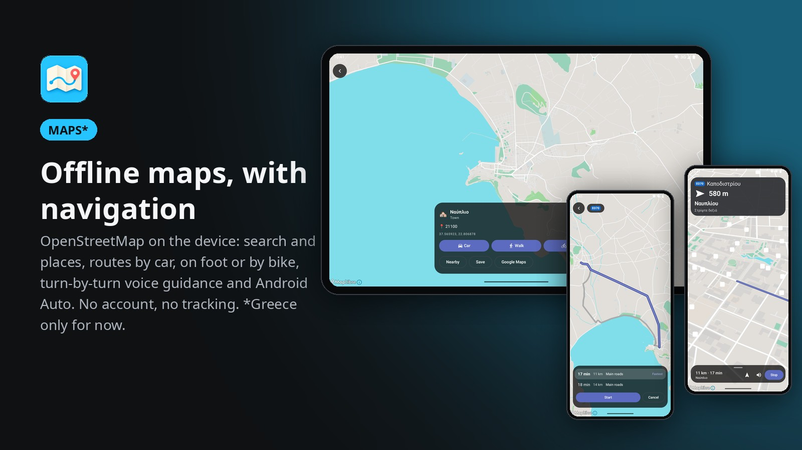


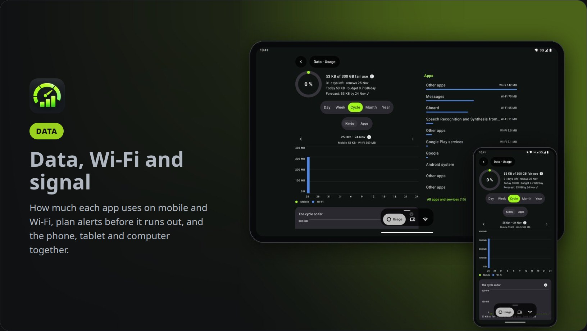
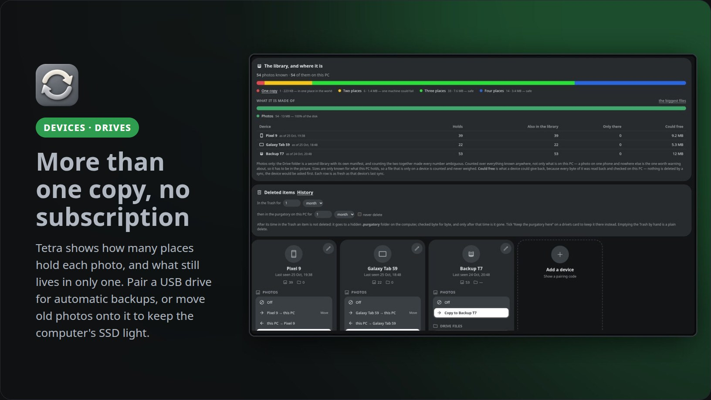
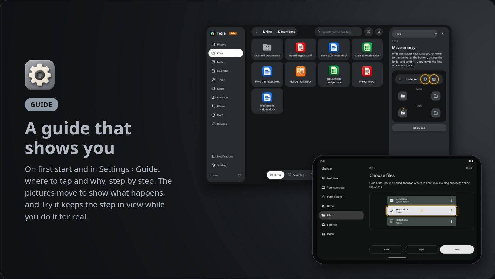
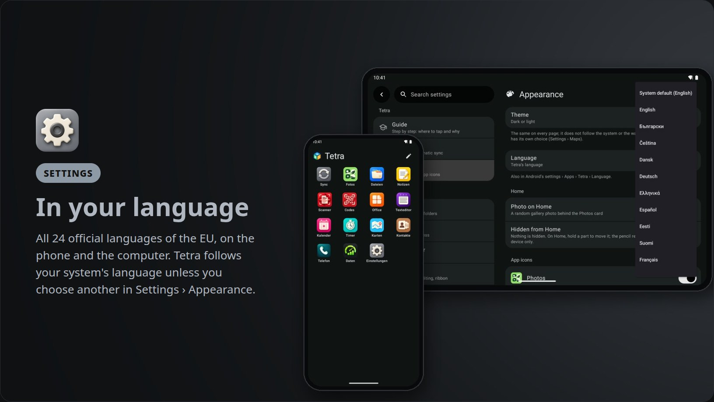

Also inside: **Scanner** (paper to PDF, the page found live and straightened), **Codes** (QR codes, barcodes, text
in a photo, Greek RF payment codes) and a **Text editor** with tabs. Every applet has a phone and a tablet layout; see
each one's screenshots, phone, tablet and computer apart, on [the Tetra page](https://kalotrapezis.github.io/Drive-Android/).
The full list is in [FEATURES.md](FEATURES.md).

## Fast

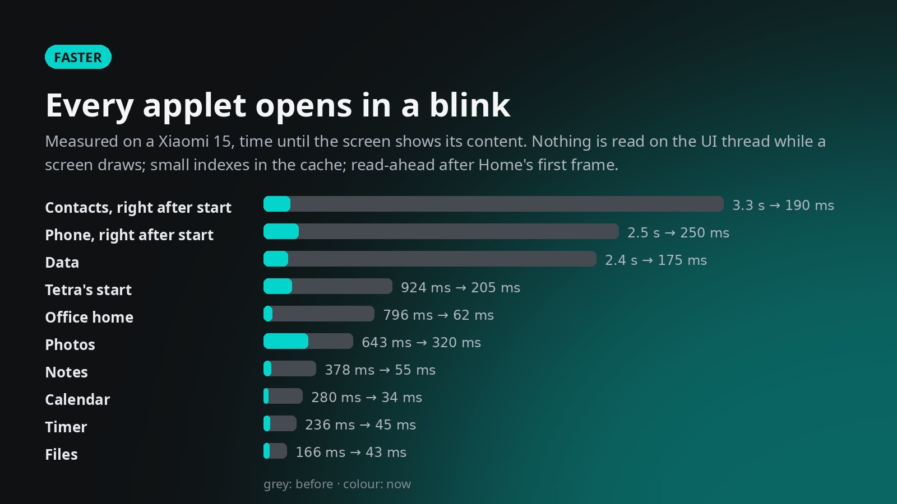

This release went through every applet, one by one, with the same recipe: nothing is read or worked out on the
screen's thread while it draws; the list shows first and side work comes after; read-ahead starts after Home's first
frame; small indexes in the app's cache mean a restart does not read every file again; and lists are made for
thousands of items, so Tetra left open for months does not grow. The build installed on devices is no longer
debuggable, which alone made Compose several times faster.

<details><summary>All the numbers</summary>

| On a Xiaomi 15, until the screen shows its content | before | now |
|---|---|---|
| Contacts, opened right after Tetra starts | 3.3 s | 0.19 s |
| Phone, opened right after Tetra starts | 2.3–2.8 s | 0.25 s |
| Tetra's start to its first frame | 924 ms | 157–253 ms |
| Home's first frame | 519–586 ms | 83–100 ms |
| Data | 2353–2426 ms | 157–194 ms |
| Notes | 348–407 ms | 45–66 ms |
| Calendar | 268–291 ms | 32–35 ms |
| Photos (tapped at once) | 619–667 ms | 266–375 ms |
| Office home | 711–881 ms | 59–65 ms |
| Files | 159–173 ms | 37–49 ms |
| Timer | 226–246 ms | 38–52 ms |
| Contacts | 157–218 ms | 32–38 ms |

On a tablet with 218 notes, Notes opened in about 450 ms instead of 1000 ms before the build change, and in about
90 ms after it.

</details>

## Sync with your computer

Pair once with [Tetra for the desktop](https://github.com/kalotrapezis/Drive) by QR code. Each file is checked by
SHA-256 on arrival. Rules per device: send only, both ways, or **Move** (keep a month on the phone, the rest lives on
the computer). The design and every rule's reason are in [SYNC_PLAN.md](SYNC_PLAN.md).

## Safety rules

- **Nothing is changed without asking.** Editing a photo in place goes through Android's own consent prompt;
  everything else saves a new file.
- **Deleting is always reversible first.** Items go to a Trash, then (on the computer) a purgatory, and only then
  away for good. Emptying the Trash always asks you first.
- **A copy counts only once it is verified.** A photo can leave the phone (Move) only after the computer has
  confirmed it holds the same bytes.
- **Files never leave `/sdcard/Tetra`.** Every path is checked against it.
- **Nothing is sent to anyone else.** No account, no analytics, no ads. Permissions are asked for only where they
  are used.

## Install

Download the APK from [Releases](https://github.com/kalotrapezis/Drive-Android/releases) (`arm64` for nearly every
phone from the last few years) and open it; Android asks once to allow installs from your browser. Android 11 or
newer. Updates install over the old version and keep everything.

For your computer: [Tetra for the desktop](https://github.com/kalotrapezis/Drive) (AppImage or .deb).

## Build

Requires JDK 17 and the Android SDK (Gradle 8.14 does not run on JDK 25).

```bash
export ANDROID_HOME=~/Android/Sdk
export JAVA_HOME=/usr/lib/jvm/java-17-openjdk-amd64
./gradlew testDebugUnitTest assembleDebug
adb install -r app/build/outputs/apk/debug/app-arm64-v8a-debug.apk
```

Kotlin + Jetpack Compose, min SDK 30, target SDK 36. The package id `com.kalotrapezis.drive` keeps the app's old
name on purpose: changing it would make every existing install a different app.

## Documentation

| File | Purpose |
|---|---|
| [FEATURES.md](FEATURES.md) | What is implemented now, per module |
| [SYNC_PLAN.md](SYNC_PLAN.md) | Sync design and every rule's reason (the same file in both repos) |
| [Plan.md](Plan.md) | The work plan and its measurements |
| [HANDOFF.md](HANDOFF.md) | Where work stands |
| [THIRD_PARTY_NOTICES.md](THIRD_PARTY_NOTICES.md) | Bundled models and library licences |

## Licence

Tetra is free software, and will stay free: [GNU GPL 3.0 or later](LICENSE) (until 25 October 2026 the GPL 2.0). The
libraries it bundles and their licences, MuPDF under the AGPL 3.0 among them, are in
[THIRD_PARTY_NOTICES.md](THIRD_PARTY_NOTICES.md).
